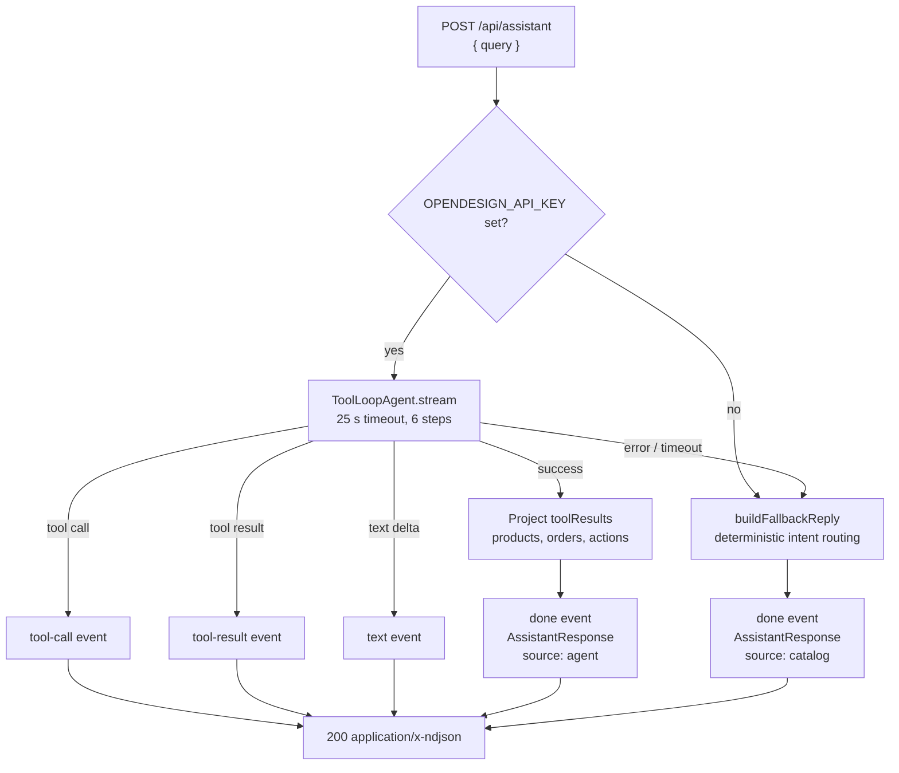

# Northline AI guide

The guide is the chat surface behind the floating “Ask Northline” button and every
“Ask the guide” link. It answers catalog, bag, checkout and order questions. It is
**optional infrastructure**: without an API key, or when the model call fails, a deterministic
catalog implementation answers instead.

Entry point: `POST /api/assistant` → `streamAssistantReply(query, user)` in
`lib/assistant-agent.ts`.

## 1. Two modes



Both modes emit the same event contract, so the widget does not branch on mode. The
`done` event carries the complete `AssistantResponse` used for cards and actions.

## 2. Streaming contract

`POST /api/assistant` returns `application/x-ndjson`; each line is one
`AssistantStreamEvent`:

```ts
type AssistantStreamEvent =
  | { type: "reasoning"; text: string }
  | { type: "reasoning-reset" }
  | { type: "text"; text: string }
  | { type: "tool-call"; id: string; name: string; input: unknown }
  | { type: "tool-result"; id: string; status: "done" | "error" }
  | { type: "done"; response: AssistantResponse }
  | { type: "error"; message: string };
```

Ordering: a `tool-call` precedes its matching `tool-result`; `reasoning` and `text`
deltas arrive as the model produces them; exactly one `done` closes a successful stream.
A provider or timeout failure emits `tool-result` errors for still-running calls,
`reasoning-reset` if reasoning was streamed, then a fallback `done`. The final response is:

```ts
type AssistantResponse = {
  intent: "shopping" | "orders" | "cart" | "checkout" | "account" | "catalog" | "help";
  reply: string;
  products: Product[];
  orders: OrderSummary[];
  actions: { label: string; href: string; primary?: boolean }[];
  filters: AssistantFilters | null;
  source: "agent" | "catalog";
};
```

`Product` and `OrderSummary` are the same DTOs used by the storefront
(`lib/types.ts`). While the stream runs the widget:

- appends `reasoning` deltas to a collapsible `Thinking…` block,
- appends `text` deltas to the pending bot bubble,
- renders each `tool-call` as a compact trace row (`search_products` plus its input),
- marks the row done/error from `tool-result`,
- clears the thinking block on `reasoning-reset`.

On `done` it replaces the partial text with `response.reply` and renders:

- up to four product cards (image, name, category, price),
- up to three order cards (id, date, total, status pill),
- action links, with the `primary` one styled differently,
- the tool trace, retained above the reply.

The widget closes when a card or action link is followed.

## 3. Agent mode

### 3.1 Construction

`buildAgent(user)` runs per request:

```ts
createOpenAICompatible({
  name: "northline",
  baseURL: process.env.OPENDESIGN_API_URL ?? "https://amr-link.open-design.ai/v1",
  apiKey: process.env.OPENDESIGN_API_KEY,
})
```

The base URL has a trailing slash removed; the model id defaults to
`deepseek-v4.1-flash`. The agent is constructed with:

| Setting | Value |
| --- | --- |
| Step cap | `stopWhen: isStepCount(6)` |
| Temperature | `0.1` |
| Output cap | `maxOutputTokens: 900` |
| Request timeout | `AbortController` aborts after 25 s or when the request disconnects |
| Conversation history | none — one prompt per request |

### 3.2 Instructions

The system prompt establishes:

- It is the Northline tech guide.
- Every product recommendation, price, stock and category answer must come from a tool.
- It must never invent products, prices, stock or categories.
- If a search returns nothing, it may suggest only a category or budget that came from a
  tool result.
- It uses `find_product` for named items, `list_categories` for store scope,
  `view_cart`/`view_orders`/`view_order` for account questions.
- When a tool returns `signedIn: false`, it asks the user to sign in and does not claim
  knowledge of their bag or orders.
- It cannot place, cancel or modify orders; it directs users to checkout/order/bag pages.
- Prices are USD; replies should be one short plain-text paragraph, at most 90 words, with no
  markdown tables, headings or bullet lists.

These are prompt constraints, not hard enforcement. The UI-level guarantee is described in
§6.

### 3.3 Tools

All tools are read-only and close over the request’s `SessionUser | null`.

| Tool | Input (Zod) | Reads | Returns |
| --- | --- | --- | --- |
| `search_products` | `query?` ≤200; `category?` ∈ six categories; `minPrice?`/`maxPrice?` 0–100,000 USD; `keywords?` string[] ≤8 | `listProducts()` + `parseGearQuery` + `matchProducts` | `{ total, filters, products: top 8 }` |
| `find_product` | `id?` ≤80; `name?` ≤160 | `listProducts()`, `getProduct` | `{ product }` or `{ product: null }` |
| `list_categories` | none | `listProducts()` | `{ categories: [{ name, count }] }` for all six |
| `view_cart` | none | `getCartLines(user.id)` | `{ signedIn: false }` or `{ signedIn: true, lines, count, subtotalCents, shippingCents, taxCents, totalCents }` |
| `view_orders` | `limit?` 1–10; `status?` | `listOrders(user.id)` | `{ signedIn: false }` or `{ signedIn: true, total, orders: first N (default 3) }` |
| `view_order` | `orderId` 1–40 | `getOrder(user.id, orderId)` | `{ signedIn: false }` or `{ signedIn: true, order }` |

`search_products` merges the model’s `query`/`keywords` with `parseGearQuery` output, maps USD
to cents with a 100,000 cap, deduplicates and trims keywords to 8, and returns only the first
8 matches. `find_product` tries the id, then an exact case-insensitive name, then a substring
name match.

Account tools return `signedIn: false` rather than throwing when there is no session.

### 3.4 Projection into the response

The route does **not** trust the model to assemble cards. It consumes `result.stream`,
forwards `reasoning-delta`, `text-delta`, `tool-call` and `tool-result` events, and collects
completed `tool-result` parts. It then builds maps from those results:

| Tool result | Effect |
| --- | --- |
| any payload with `signedIn === false` | `authRequired = true` |
| `search_products` | `usedCatalog`, add returned products, remember `total`, remember `filters` |
| `find_product` | `usedCatalog`, add the product if non-null |
| `list_categories` | `usedCategories` |
| `view_cart` | `usedCart`, remember `count`, add line products |
| `view_orders` / `view_order` | `usedOrders`, add returned order summaries |

Then:

- `productList` = unique products in first-seen order, sliced to **4**.
- `orderList` = unique orders in first-seen order, sliced to **3**.
- `reply` = `plainText(concatenated text deltas)`, falling back to a generated one-liner if
  the model returned no text. `plainText` strips `**bold**`, backticks and line breaks.
- `intent` is assigned by priority: orders → cart → shopping (catalog) → catalog
  (categories) → help.
- `source` is `"agent"`.

Action precedence:

1. `authRequired` → “Sign in” (primary) + “Create account”.
2. `usedCart` → “Open bag” (primary) + “Checkout” when the cart count is non-zero.
3. `usedOrders` → one order link (primary) when exactly one order, otherwise “View all
   orders”.
4. Exactly one product → “View <name>” (primary) + “Browse the catalog”.
5. Multiple products / catalog / categories → “Browse the catalog” (primary).
6. No action yet → “Browse the catalog” (primary).

If the tool reported more matches than the four shown, an extra action links to
`filtersToHref(filters)` — for example
`/?q=headphones&category=Audio&max=400&assistant=1`.

## 4. Fallback mode

Triggered when:

- `OPENDESIGN_API_KEY` is unset,
- `agent.stream` throws, times out or is aborted,
- the stream emits an `error` part,
- an error occurs while projecting results.

The catch logs `console.warn("Tech guide agent request failed", message)`, marks still-running
tool calls as `error`, emits `reasoning-reset` if any reasoning was already sent, and emits a
fallback `done` from `buildFallbackReply(query, user)`. Partial text is replaced by the client
when `done` arrives; the reset clears partial reasoning.

### 4.1 Intent routing

`buildFallbackReply` evaluates rules in this order and returns the first match:

| Order | Trigger | Behaviour |
| --- | --- | --- |
| 1 | Greeting (`hi`, `hello`, `hey`) | Intro + catalog size |
| 2 | Thanks | Short acknowledgement |
| 3 | “what can you do”, “how does this work”, `help` | Capability summary |
| 4 | `NL-####` or order/tracking/cancel words | Auth prompt, exact order, empty history, or latest orders |
| 5 | `cart` / `basket` / “my bag” | Auth prompt, empty bag, or count + subtotal |
| 6 | checkout / place order | Auth prompt, empty bag, or totals + checkout action |
| 7 | sign in / account / password | Guest prompt or signed-in profile summary |
| 8 | catalog / browse / shop | Catalog size + first three products |
| 9 | Exact full product name appears in the query | Product description + price + action |
| 10 | Anything else | `parseGearQuery` + `matchProducts` and render zero/one/many results |

Order lookup only searches the signed-in user’s orders; an unknown id returns the user’s
latest orders. There is no cross-user lookup.

### 4.2 Query parsing

`parseGearQuery(query)` (in `lib/assistant.ts`) extracts:

- **Price range:** `between A and/to/- B`; otherwise `under|below|less than|up to|max A` for a
  maximum, and `over|above|more than|starting at|from A` for a minimum. `$`, `¥` and `￥`
  symbols are accepted; commas are stripped. Values are converted to cents and capped at
  $100,000.
- **Category:** keyword groups for Phones, Computers, Audio, Gaming, Wearables and
  Accessories (e.g. “laptop/macbook/tablet” → Computers; “ps5/xbox/switch/controller” →
  Gaming).
- **Keywords:** lower-cased words longer than two characters, minus a stop-word list,
  deduplicated and capped at 8.

`matchProducts(products, filters)`:

1. Filter by exact category.
2. Filter by min/max cents.
3. If keywords exist, keep products whose `name + tags` contains every keyword, allowing
   simple plural forms (`-s`, `-es`, `-ies`).
4. If no keyword match exists and a category was supplied, keep the category/price results;
   otherwise return empty.
5. Sort by score: name match 4, tag match 2, full haystack (`name + category + tagline +
   description + tags`) 1.

The fallback uses the same `matchProducts` as `/api/products` and the agent’s
`search_products`.

### 4.3 Fallback response details

- `intent` is chosen by the matched rule (`help`, `orders`, `cart`, `checkout`, `account`,
  `catalog`, `shopping`).
- `source` is always `"catalog"`.
- Products are capped at 3 in shopping/catalog replies.
- If a category/price search returns nothing, the closest item in that category is offered
  with its real price; the reply explicitly says nothing fits the filter.
- `filtersToHref` builds the catalog URL from keywords, category and price bounds and always
  adds `assistant=1`.

## 5. Data access and ownership

The guide never writes. It calls only `listProducts`, `getProduct`, `getCartLines`,
`listOrders` and `getOrder`; the last three receive `user.id` from the route’s session.
There is no tool that can add to cart, place, cancel or modify an order.

The model receives:

- the user’s query,
- catalog rows returned by search/lookup,
- for signed-in users, bag lines and order summaries/details — including the shipping
  address when `view_order` is used.

It does not receive passwords, session tokens or other users’ data.

## 6. Guardrails

| Guardrail | Mechanism | Strength |
| --- | --- | --- |
| No invented product cards | `products`/`orders` are projected from tool results only | Hard, code-enforced |
| Real prices and stock | Tool results come from SQLite at request time | Hard |
| No account writes | Read-only tool set | Hard, code-enforced |
| No cross-user reads | Tools receive `user.id` from the session; `getOrder` is scoped | Hard |
| Sign-in required messaging | `signedIn: false` → `authRequired` → sign-in actions | Hard |
| No markdown/HTML injection | Reply is rendered as a React text node; `plainText` strips markdown | Hard |
| Action URLs | Built from catalog categories/order ids; `URLSearchParams` encodes filters | Hard |
| No invented prose | System instructions | Prompt-level only |
| Prompt-injection resistance | Product content is data; instructions say to use only tools | Prompt-level only |

Residual risks:

- The model can still write incorrect prose (wrong comparison, invented claim) even though
  the cards beside it are real.
- Catalog text is operator-controlled but could contain instruction-like content; the model
  may follow it. Cards remain DB-backed, but the reply is not guaranteed clean.
- The provider sees the query, catalog excerpts and the signed-in user’s own account data.
- There is no moderation layer, PII redaction, cost cap per user or rate limit.

## 7. Configuration and failure behaviour

| Variable | Effect when missing |
| --- | --- |
| `OPENDESIGN_API_KEY` | Fallback mode for every request |
| `OPENDESIGN_API_URL` | `https://amr-link.open-design.ai/v1` |
| `OPENDESIGN_MODEL` | `deepseek-v4.1-flash` |

Failure handling:

| Failure | Result |
| --- | --- |
| No key | Deterministic fallback stream, `source: "catalog"` |
| Provider HTTP error / rate limit | Caught → fallback `done` |
| 25 s timeout | `AbortController` aborts → fallback `done` |
| Tool execution error | `tool-error` part → trace marked error; the agent may continue |
| Projection error | Caught → fallback `done` |
| Fallback itself throws after streaming starts (e.g. DB error) | `error` event |
| Fallback itself throws before streaming starts | Route returns `500` |
| Agent returns no text | Generated one-line summary + projected cards |

There is no app-level retry or token accounting. The 25 s abort covers the whole tool loop.

## 8. Client integration

- `chat-widget.tsx` holds messages in local state (`id`, role, text/reasoning/response,
  toolCalls, pending). It posts `{ query }`, reads the NDJSON stream, appends `text` and
  `reasoning` deltas, updates the tool trace from `tool-call`/`tool-result`, and replaces the
  pending message with the `done.response`.
- `chat-widget-views.tsx` renders reasoning in a collapsible block that starts open and can
  be collapsed by the user.
- A refresh loses the conversation; nothing is stored server-side.
- `components/chat-events.ts` defines `northline:open-guide`. `GuideButton` dispatches it
  with an optional query; the widget opens and sends that query immediately.
- The widget is hidden on `/signin` and `/signup` (`usePathname`).
- Suggestion chips: “Laptops under $1,500”, “Headphones under $400”, “Where's my order?”,
  “What's in my bag?”.
- Successful product/order/action links close the panel.
- Errors are shown as a bot text message; the HTTP layer returns
  `{ error }` only for 422/500 before the stream starts.

## 9. Limitations and extension points

Limitations:

- English keyword rules; no locale support.
- Fallback intent matching is regex-based and can misfire on unusual phrasing.
- The agent has no memory across requests and no clarification loop beyond one response.
- Product cards are truncated at four; the “see all” link is the only path to the rest.
- The client-side catalog filter and `matchProducts` are separate implementations; a guided
  link can show a different set than the reply described.
- The tool trace shows the call and status, not the full tool output.

Extension points:

- Add a `compare_products` tool that returns two catalog rows for a structured comparison.
- Persist conversations (requires a new table and ownership checks) if multi-turn context is
  needed.
- Add an eval suite with fixed catalog snapshots to catch prompt/tool regressions.
- Share one search implementation between `matchProducts`, the client grid and
  `/api/products`.
- Add per-user rate limiting and a provider spend cap before exposing this publicly.
