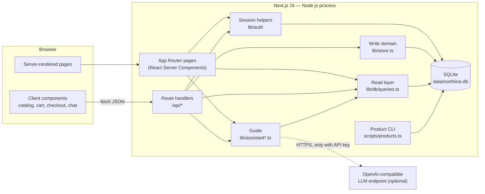
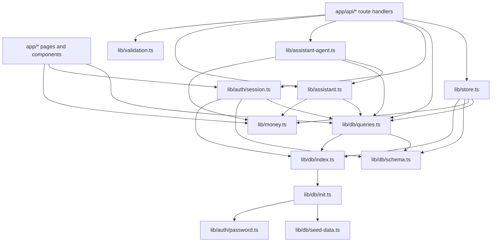
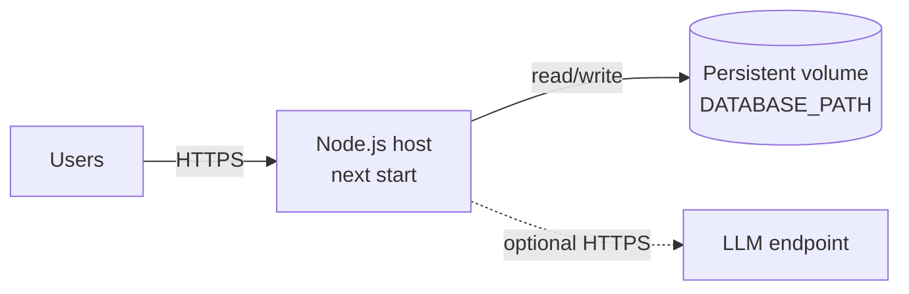

# Northline architecture

## 1. Scope

This document describes how the Northline storefront is assembled and why. It covers the
runtime topology, module boundaries, rendering model, request lifecycles, security posture,
deployment constraints and known gaps. Data structures are detailed in
[data-model.md](./data-model.md); HTTP contracts in [api.md](./api.md); the shopping guide in
[ai-assistant.md](./ai-assistant.md).

Northline is a demo-grade but production-shaped electronics shop: real accounts, persisted
carts, transactional inventory, order history and an optional LLM shopping guide. It
deliberately has no payment processing, email delivery or admin UI.

## 2. System context



There is **one deployable unit**: the Next.js application. Pages, JSON APIs, authentication,
domain logic and the database driver all run in the same Node.js process. The only external
dependency is an optional OpenAI-compatible HTTPS endpoint for the guide.

## 3. Technology stack

Versions are from `package.json` at the time of writing.

| Layer | Choice | Role |
| --- | --- | --- |
| Framework | Next.js `16.4.2` App Router | Server components, routing, route handlers, image optimisation |
| UI runtime | React / React DOM `19.3.0` | Server and client rendering |
| Language | TypeScript 5, strict | `tsconfig.json`, path alias `@/*` → repository root |
| Styling | Tailwind CSS v4 via `@tailwindcss/turbopack` | CSS-first tokens; no `tailwind.config` file |
| Components | shadcn `4.22.1`, style `base-nova`, `@base-ui/react` | `components/ui/*` primitives; `cn` from the `cn` package |
| Icons | `lucide-react` | UI icons |
| Database | SQLite via `better-sqlite3` `13` | Single-file, synchronous, in-process |
| ORM | Drizzle ORM `0.45` (`better-sqlite3` driver) | Schema definitions and typed queries |
| Validation | Zod `4` | Request-body and query-boundary schemas |
| AI | Vercel AI SDK `7` (`ToolLoopAgent`) + `@ai-sdk/openai-compatible` | Optional tool-calling shopping guide |
| CLI | `tsx` + Drizzle | Catalog management from the terminal |

`next.config.ts` enables:

```ts
cacheComponents: true,
partialPrefetching: true,
serverExternalPackages: ["better-sqlite3"],
turbopack: { rules: { "*.css": { loaders: ["@tailwindcss/turbopack"], as: "*.css" } } }
```

`serverExternalPackages` keeps the native SQLite addon out of the bundler. Cache Components
requires the Node.js runtime, so there is no Edge deployment target.

## 4. Repository map

```text
app/
  layout.tsx                  root shell: session, cart/order counts, header/footer, chat, toasts
  page.tsx                    home: server-loaded catalog + client-side filtering
  product/[id]/page.tsx       product detail, related items, buy-now
  cart/page.tsx               server-rendered bag, empty/auth states, summary
  checkout/page.tsx           cart or buy-now checkout, stock re-check, shipping form
  orders/page.tsx             order list + client status filters
  orders/[id]/page.tsx        order detail, timeline, cancel/reorder
  signin/page.tsx             sign-in or signed-in profile
  signup/page.tsx             account creation
  not-found.tsx               shared 404 surface
  api/                        JSON route handlers (see docs/api.md)
  globals.css                 Tailwind v4 entry + design tokens
  app.css                     hand-authored component styles (~35 KB)

components/
  ui/                         shadcn/Base UI primitives (button, badge, card, dialog, input, label)
  catalog-browser.tsx         client search/category/price/sort; URL sync via replaceState
  product-card.tsx            presentational card used by RSC pages and the client grid
  product-purchase.tsx        quantity stepper, add-to-bag, buy-now
  cart-lines.tsx              optimistic quantity/remove updates
  checkout-form.tsx           client validation + POST /api/orders
  orders-explorer.tsx         client status filter over server data
  chat-widget.tsx             global guide dialog, suggestion chips, POST /api/assistant
  chat-widget-views.tsx       guide messages, product/order cards, action links
  toast-provider.tsx          success/warn toast context
  site-header.tsx             account menu, bag count, logout
  site-footer.tsx, summary.tsx, order-visuals.tsx, auth-aside.tsx, ...

lib/
  db/schema.ts                Drizzle table definitions and row types
  db/init.ts                  raw DDL, first-boot seed, seed transaction
  db/index.ts                 connection singleton, pragmas, schema bootstrap
  db/queries.ts               synchronous read queries and row → DTO mappers
  db/seed-data.ts             18 products, sample account, 4 sample orders
  store.ts                    write domain: cart, place/cancel/reorder, StoreError
  auth/session.ts             cookie session create/destroy, cached getSessionUser
  auth/password.ts            scrypt hash/verify
  validation.ts               Zod schemas + field error flattening
  api.ts                      JSON error envelope + safe body parsing
  money.ts                    cents, totals, formatting, stock labels
  types.ts                    Product, CartLine, OrderSummary, OrderDetail, SessionUser
  catalog.ts                  the six category names
  assistant.ts                deterministic search, fallback replies, filter → URL
  assistant-agent.ts          optional ToolLoopAgent and tool result projection
  auth-url.ts, redirect.ts    login-resume parameters, safe `next` validation

scripts/products.ts           list/show/add/update/delete catalog rows
data/northline.db             local SQLite database (gitignored, created on first boot)
public/assets/tech/           product and hero imagery
reference/index.html          visual design reference
```

## 5. Runtime and process model

### 5.1 One process, one database handle

`lib/db/index.ts` creates the connection at module evaluation:

1. Resolve `DATABASE_PATH` (relative paths resolve against `process.cwd()`), defaulting to
   `data/northline.db`.
2. Create the parent directory.
3. Open `better-sqlite3` and apply pragmas:

   | Pragma | Value | Effect |
   | --- | --- | --- |
   | `journal_mode` | `DELETE` | Rollback journal, not WAL; one writer at a time |
   | `synchronous` | `NORMAL` | Fewer fsyncs; durable enough for this demo |
   | `foreign_keys` | `ON` | Enforces the declared relationships |
   | `busy_timeout` | `5000` | Wait up to 5 s for a competing writer |

4. Run `initializeDatabase(sqlite)` — `CREATE TABLE IF NOT EXISTS` for all tables, then a
   guarded seed (`counters.seeded` marker) inside an immediate transaction.
5. Wrap the handle with Drizzle.

The resulting store is cached on `globalThis` in development so HMR does not open a new
handle per module graph; production keeps the module-level singleton. Every server component
and route handler that imports `lib/db` shares that handle.

### 5.2 Synchronous data access

`better-sqlite3` is synchronous. Queries use `.all()`, `.get()` and `.run()` directly; there
is no `await` between a read and its use inside a request. Writes that must be atomic use
`db.transaction((tx) => { ... })` with a synchronous callback. SQLite serialises writers, and
the stock updates rely on that serialisation plus a conditional `WHERE stock >= qty`.

### 5.3 Node-only assumptions

- `better-sqlite3` is a native addon, externalised from the bundle.
- Cache Components requires the Node.js runtime.
- The filesystem must persist between requests. Serverless hosts with an ephemeral
  filesystem are not a supported target without a mounted volume.
- A single instance is assumed. Multiple replicas writing separate local files would each
  see their own catalog and orders.

## 6. Rendering, caching and navigation

### 6.1 Dynamic pages with a static shell

All route pages that render storefront content, plus the root layout, export:

```ts
export const instant = false;
```

In this Next.js version, `instant = false` opts the segment out of instant-navigation and
static-shell validation. It does not make the page static.

Every content page calls `await io()` before reading synchronous state (SQLite, `Date`,
`crypto`). `io()` suspends during prerendering so the code after it is excluded from the
static shell and runs per request. Pages also read the session through `cookies()`, which is
itself a request-time API.

`getSessionUser` is wrapped in React `cache()`, so the layout and the page share one session
lookup per request.

There is **no** `use cache`, `cacheLife`, `cacheTag`, `revalidate` or route-handler caching in
the application. Catalog, cart and order data are read from SQLite on each request.
`partialPrefetching` and Cache Components are enabled for navigation behaviour (route app
shells, preserved client state), not to cache business data.

### 6.2 Server/client boundary

| Concern | Server | Client |
| --- | --- | --- |
| Catalog read | `listProducts()` in `app/page.tsx` | receives the full product array |
| Catalog filtering | none after load | `catalog-browser.tsx` filters in memory |
| Cart read | `getCartLines()` in `/cart`, `/checkout` | receives initial lines |
| Cart writes | route handlers | `fetch` then `router.refresh()` |
| Checkout | server re-validates stock and totals | form validation + `POST /api/orders` |
| Orders | `listOrders` / `getOrder` | status filter in `orders-explorer.tsx` |
| Guide | `POST /api/assistant` | chat widget state and message rendering |

Client components never import `lib/db`. They import pure helpers (`money`, `types`,
`catalog`) and call JSON endpoints. `product-card.tsx` is environment-agnostic: it has no
server-only imports, so it renders inside both the server product page and the client
catalog grid.

### 6.3 URL state

The catalog keeps search, category, price bounds, sort and the `assistant=1` marker in the
URL. `CatalogBrowser` writes them with `window.history.replaceState` (no server round trip),
and `app/page.tsx` parses the same parameters for first render. The component receives a
`key` built from those parameters, so navigating to a guide-generated link remounts it with
the new initial state.

`assistant=1` only changes the UI: it shows the “Guided by …” note and clears the marker on
the next manual filter change. It does not affect filtering logic.

### 6.4 Images and assets

`next/image` serves local files from `public/assets/tech`. Product rows store the public path
in `products.image`; order rows snapshot it. No remote image domains are configured.

## 7. Layering and dependency rules



Rules the code follows:

- **Schema** defines tables; **init** owns DDL and seeding; neither contains business rules.
- **Queries** are read-only and return DTOs (`lib/types.ts`), not raw rows.
- **Store** owns every multi-step write and throws `StoreError(status, message)`.
- **Validation** is the untrusted-input boundary; route handlers and pages do not parse raw
  JSON themselves.
- **API helpers** turn `StoreError` into the `{ error }` envelope and hide unexpected
  failures behind a generic 500.
- **Auth helpers** own cookies and password hashing; route handlers never read the cookie
  directly.
- **Pure helpers** (`money`, `catalog`, `redirect`, `auth-url`) have no I/O.

## 8. Request lifecycles

### 8.1 Page render

```mermaid
sequenceDiagram
  participant B as Browser
  participant L as Root layout
  participant P as Page (RSC)
  participant S as getSessionUser
  participant Q as queries.ts
  participant D as SQLite

  B->>L: GET /product/iphone-15-pro
  L->>L: await io()
  L->>S: read northline_session cookie
  S->>D: sessions JOIN users WHERE token, expires_at > now
  L->>Q: getCartCount(), getOrderCount() (signed in only)
  Q->>D: SELECT
  L->>P: render children
  P->>P: await io(); awaits params/searchParams
  P->>Q: getProduct(), listProducts()
  Q->>D: SELECT
  P-->>B: streamed HTML + RSC payload
```

Auth-gated pages do not redirect automatically. They render `AuthRequired` with a `next`
path, so the browser stays on a friendly surface; `/signup` is the exception and redirects an
already-signed-in user to `next`.

### 8.2 Mutation

```mermaid
sequenceDiagram
  participant C as Client component
  participant R as Route handler
  participant S as getSessionUser
  participant V as Zod schema
  participant D as lib/store.ts
  participant DB as SQLite

  C->>R: POST /api/orders (JSON)
  R->>S: cookie -> SessionUser | null
  alt no session
    R-->>C: 401 { error }
  else session
    R->>V: safeParse(body)
    alt invalid
      R-->>C: 422 { error, fields }
    else valid
      R->>D: placeOrder(user.id, input)
      D->>DB: BEGIN (deferred)
      D->>DB: conditional UPDATE products SET stock = stock - qty
      alt changes = 0
        D-->>R: StoreError(409)
        D->>DB: ROLLBACK
        R-->>C: 409 { error }
      else
        D->>DB: INSERT order, items, event; clear cart
        D->>DB: COMMIT
        D-->>R: { orderId }
        R-->>C: 201 { orderId }
      end
    end
  end
```

Client components treat the JSON response as authoritative and call `router.refresh()` to
re-render server data. Cart mutations update optimistically and roll back to `initialLines`
on failure.

## 9. Domain modules

### 9.1 Catalog

- `products` rows are the single source of truth for price, stock and presentation.
- `listProducts` orders by `featured_order`, then name.
- The home page sends the entire catalog to the browser (18 rows at seed time) and filters in memory.
- `/api/products` exposes a separate server-side search (`parseGearQuery` + `matchProducts`)
  with `q`, `category`, `min`, `max`, `sort`. The current UI does not call it.
- Catalog administration is CLI-only (`scripts/products.ts`); there is no admin route or UI.
- Deleting a product cascades to `cart_items` but not to `order_items`, which are snapshots.

### 9.2 Cart

- Keyed by `(user_id, product_id)`; quantity is the only mutable field.
- Add: one transaction reads the product, checks `existing + qty <= stock`, then upserts.
- Set: `qty = 0` removes; otherwise checks the product and stock, then upserts. The check and
  write are separate statements; checkout re-validates atomically.
- Carts do **not** reserve stock. Another shopper can buy the last unit between add and
  checkout.

### 9.3 Checkout and orders

Two inputs share one path:

```ts
{ source: "cart", shipping }
{ source: "buy-now", productId, qty, shipping }
```

`placeOrder` runs entirely inside one transaction:

1. Resolve lines (cart join or the buy-now product) and reject empty carts / invalid qty.
2. Pre-check stock for a friendly message.
3. For each line, `UPDATE products SET stock = stock - qty WHERE id = ? AND stock >= qty`.
   A non-1 row count means another writer won; throw `StoreError(409)` and roll back.
4. Compute subtotal from **current product prices**, then shipping/tax/total via
   `lib/money.ts`.
5. Allocate the order id from `counters` with an atomic upsert/`RETURNING`.
6. Insert `orders`, snapshot each `order_items` row, insert the `Processing` event.
7. Clear the cart only for `source: "cart"`; buy-now leaves the bag untouched.

Cancellation (`cancelOrder`) only accepts `Processing` or `Packed`. It conditionally updates
the order, restores each item's quantity to `products.stock`, and appends a `Cancelled`
event — all in one transaction. A concurrent second cancel fails the conditional update.

Reorder (`reorder`) reads the order and items, then adds each still-available item to the
bag inside a transaction, clamped to `stock - alreadyInCart`. It skips products that were
deleted or are out of stock and returns `{ added, limited }`.

### 9.4 Authentication

- Passwords: `scrypt` with a random 16-byte salt and 64-byte derived key, stored as
  `scrypt$<saltHex>$<hashHex>`; verification uses `timingSafeEqual`.
- Sessions: 32 random bytes, base64url, stored as the `sessions.token` primary key with a
  30-day expiry. The cookie is `northline_session` (`httpOnly`, `sameSite=lax`,
  `secure` in production, `path=/`).
- `getSessionUser` reads the cookie, joins the session to the user, and compares ISO expiry
  strings. Expired sessions are ignored but not deleted.
- `destroySession` deletes the row and expires the cookie.
- Signup normalises email to lower case (Zod), checks for duplicates, inserts, then creates
  the session. A uniqueness race is caught and returned as 409.
- Login resumes a pending add-to-bag action after authentication using `add`/`qty` query
  parameters (`lib/auth-url.ts`).
- `safeNextPath` accepts only single-slash local paths, rejecting `//host` and backslashes.

### 9.5 Guide

`app/api/assistant/route.ts` delegates to `buildAssistantReply`:

- With `OPENDESIGN_API_KEY`: a `ToolLoopAgent` with six read-only tools (`search_products`,
  `find_product`, `list_categories`, `view_cart`, `view_orders`, `view_order`), a six-step
  cap, a 25-second timeout, temperature 0.1 and a 900-token output cap.
- Without a key, or on any agent failure: deterministic intent routing and catalog search in
  `lib/assistant.ts`.

The route then projects **tool results** into the response’s `products` and `orders` arrays;
model text cannot inject a product card. See [ai-assistant.md](./ai-assistant.md).

### 9.6 Catalog CLI

`scripts/products.ts` imports the same `lib/db` singleton, so it uses the same schema, seed
and `DATABASE_PATH`. Commands: `list`, `show`, `add`, `update`, `delete`, `help`. `add`
slugifies the name unless `--id` is supplied. It does not migrate the schema and does not run
checkout/cancellation logic; it edits catalog rows directly, including stock.

## 10. Security model

| Area | Control | Residual risk |
| --- | --- | --- |
| Passwords | scrypt, random salt, constant-time compare | No reset, verification, lockout or rate limit |
| Sessions | random 256-bit token, HttpOnly, SameSite=Lax, Secure in prod, 30-day expiry | Token stored in plaintext in SQLite; no rotation/revocation list beyond row deletion |
| Authorization | user id comes from the session; order reads/writes are scoped by `user_id` | No roles; every signed-in user can use every route |
| Input | Zod limits on lengths, quantities, prices and enums | Some query parameters are coerced rather than rejected (checkout qty, catalog prices) |
| SQL | Drizzle parameter binding; no string-built SQL with user values | Raw DDL/seed SQL is static |
| Open redirect | `safeNextPath` local-path check | — |
| CSRF | same-site cookie; state-changing endpoints are JSON | No explicit CSRF token or Origin check |
| Error disclosure | generic 500 body; details go to server logs | Logs may contain driver messages |
| Secrets | `.env*` ignored except `.env.example`; AI key read server-side | AI endpoint receives the user’s query and read-only tool context |
| AI output | product/order cards are built only from tool results; tools are read-only and user-scoped | Model prose can still be wrong; prompt injection is mitigated, not eliminated |

There is no middleware. Authentication and ownership are enforced in each page or route
handler, so a new route must perform its own session lookup.

## 11. Configuration and deployment

### 11.1 Environment

| Variable | Default | Used by |
| --- | --- | --- |
| `DATABASE_PATH` | `data/northline.db` | `lib/db/index.ts`, CLI |
| `OPENDESIGN_API_KEY` | unset → deterministic fallback | `lib/assistant-agent.ts` |
| `OPENDESIGN_API_URL` | `https://amr-link.open-design.ai/v1` | agent provider |
| `OPENDESIGN_MODEL` | `deepseek-v4.1-flash` | agent provider |

`.env.example` documents the same keys. Next.js loads `.env.local` in development.

### 11.2 Build and run

```bash
npm install
npm run build      # next build
npm start          # next start
npm run dev        # next dev
```

Deployment shape:



Constraints:

- **Persistent disk required.** The database file must survive restarts and be writable.
- **One writer, preferably one instance.** Do not point multiple replicas at independent
  local files. Network filesystems are not a safe home for a live SQLite database.
- **No Edge runtime.** Cache Components and the native SQLite addon both require Node.js.
- **Backups:** stop the server (or at least writes) and copy the database file. With
  `journal_mode = DELETE`, there is no WAL to replay, but a transient `-journal` may exist
  during a write.
- **Scaling path:** moving to a managed database requires replacing the Drizzle driver and
  converting sync `.all()/.get()/.run()` calls to async; the domain layer currently assumes
  synchronous SQLite.

### 11.3 Reset and reseed

Stop the server, delete `data/northline.db` (and any stale `-journal`/`-wal`/`-shm` files),
then start it again. The module import recreates the schema and runs the seed once. Removing
only the `seeded` counter row while keeping data would attempt a duplicate seed and fail on
primary keys.

## 12. Operations and quality

- **Logging:** `console.error` for unexpected route failures, `console.warn` when the agent
  falls back, CLI output on stdout. No request ids, metrics, tracing or structured logs.
- **Health:** no dedicated endpoint. `GET /api/products` is a cheap read that exercises the
  database; `GET /api/cart` requires a session.
- **Errors:** in route handlers, `StoreError` carries an HTTP status and user-facing message;
  all other errors become a generic 500 (page-render failures use the framework error page).
- **Validation:** `npm run lint`, `npx tsc --noEmit`, `npm run build`. There is no automated
  test suite in the repository.
- **Manual smoke path:** sign in with the sample account, filter the catalog, add to bag,
  change quantity, check out, open the order, cancel it, confirm stock returns, reorder.

## 13. Architecture decisions

| # | Decision | Rationale | Trade-off |
| --- | --- | --- | --- |
| 1 | One Next.js app for pages and APIs | No separate service to deploy; server components can read the DB directly | Business logic is coupled to the web framework |
| 2 | SQLite + `better-sqlite3` | Zero setup, transactional stock, fast local reads | Single node, no horizontal scaling, native build step |
| 3 | Raw DDL bootstrap instead of migration tooling | First boot works with no CLI step | No versioned migrations; `CREATE TABLE IF NOT EXISTS` cannot alter existing tables |
| 4 | Server components read; route handlers write | Reads avoid an internal HTTP hop; mutations get a clear JSON contract | Two access paths to keep consistent |
| 5 | Cookie sessions in the database | Revocable server-side; simple to reason about | A DB round trip per request; token stored plaintext |
| 6 | scrypt in-process | No external auth provider or dependency | CPU cost on login/signup; no MFA |
| 7 | Integer cents everywhere | Avoids floating-point money errors | Formatting needed at each display boundary |
| 8 | Order lines are snapshots | Historical orders survive price changes and product deletion | Duplicate product data; restock silently skips deleted products |
| 9 | Conditional stock update inside a transaction | Prevents overselling under concurrent checkouts | Contention surfaces as 409 and requires a retry |
| 10 | Cart does not reserve stock | Avoids abandoned-cart inventory locks | Stock can disappear before checkout |
| 11 | No payment step | Explicit demo constraint; no PCI scope | Not a real commerce flow |
| 12 | AI guide is optional with a deterministic fallback | The shop works without a key or network | Two response paths to maintain; fallback is less fluent |
| 13 | Guide tools are read-only | The model cannot mutate carts or orders | Users are directed to UI actions instead |
| 14 | Cache Components + `io()` + `instant = false` | Correct per-request data with a prefetchable shell | Content routes opt out of instant validation; business data is never cached |
| 15 | Tailwind v4 CSS-first + shadcn Base UI | No JS theme config; accessible primitives | Two style layers (`globals.css`, `app.css`) to navigate |

## 14. Known limitations

1. **Order status only advances in seed data.** New orders are created as `Processing`; no
   admin route, job or worker moves them to `Packed`, `Shipped` or `Delivered`.
2. **No payment or email.** Checkout records an order and reserves stock; it never charges a
   card or sends a confirmation.
3. **Two catalog filters.** The home grid uses simple substring matching; the assistant and
   `/api/products` use `matchProducts` with scoring and a fallback. Guide-generated links can
   therefore show a different result set than the guide described.
4. **`/api/products` is unused by the UI.** It is a public read API and must be maintained
   separately from the client filter.
5. **No migrations.** Schema changes require manual SQL or a database reset; the seed only
   runs once.
6. **No idempotency key on checkout.** A retried request can create a second order.
7. **No rate limiting, lockout or CSRF token.** SameSite=Lax and JSON bodies are the only
   cross-site mitigations.
8. **Expired sessions accumulate.** They are ignored by queries but never purged.
9. **Single-node SQLite.** No shared cache, queue or cross-instance coordination.
10. **Duplicated totals logic in the seed.** `lib/db/init.ts` has its own `totalsFor`; changes
    to `lib/money.ts` will not update sample orders.
11. **No automated tests.** Verification is lint, type-check, build and manual smoke.
12. **Guide replies are not streamed and have no server-side conversation memory.** Each
    request is independent; the widget only keeps client-side message state.

## 15. Extension points

- **New page or route:** follow the existing pattern — `await io()` before sync reads, call
  `getSessionUser()` for auth, scope queries by `user.id`, validate bodies with Zod, throw
  `StoreError` for expected failures.
- **New mutation:** put the multi-step write in `lib/store.ts` inside one transaction and add
  a route handler that maps it to JSON.
- **New table:** add it to `lib/db/schema.ts` **and** the raw `SCHEMA` string in
  `lib/db/init.ts`; existing databases need a manual migration or reset.
- **Status progression:** add an authenticated admin/worker endpoint that applies the same
  conditional-update pattern used by cancellation, plus an `order_events` row per transition.
- **Shared filtering:** extract the client substring matcher and `matchProducts` into one
  module so the grid and guide cannot diverge.
- **Postgres:** swap the Drizzle driver, make queries async, and replace the synchronous
  transaction callbacks; the schema is otherwise portable aside from SQLite-specific
  `datetime('now')` defaults and the counter upsert.
- **Observability:** add structured request logging around route handlers and a `/api/health`
  endpoint that performs a trivial `SELECT 1`.
