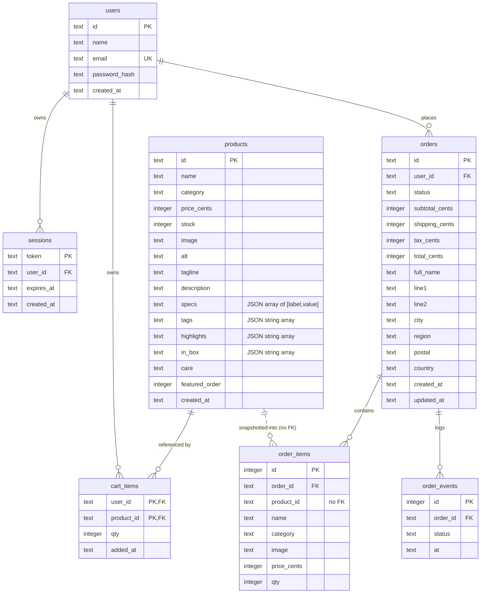

# Northline data model

Storage is a single SQLite database (`data/northline.db` by default) accessed through Drizzle
ORM. The schema is defined in two places:

- `lib/db/schema.ts` — typed Drizzle definitions used by all queries.
- `lib/db/init.ts` — raw `CREATE TABLE IF NOT EXISTS` / `CREATE INDEX IF NOT EXISTS` DDL used
  at first boot.

They must stay in sync. There is no migration tool: an existing database is never altered by
`init.ts`. Schema changes require manual SQL or a reset.

## 1. Entity relationships



`counters` is standalone:

| Column | Type | Notes |
| --- | --- | --- |
| `name` | TEXT PRIMARY KEY | `orders`, `seeded` |
| `value` | INTEGER NOT NULL | Monotonic order sequence or seed marker |

## 2. Table reference

### `products`

Catalog rows. The only writable source of product price, stock and copy.

| Column | Type | Constraints / default | Notes |
| --- | --- | --- | --- |
| `id` | TEXT | PK | Slug, e.g. `iphone-15-pro` |
| `name` | TEXT | NOT NULL | Display name |
| `category` | TEXT | NOT NULL, indexed | One of the six `CATEGORIES` strings |
| `price_cents` | INTEGER | NOT NULL | Integer cents; never a float |
| `stock` | INTEGER | NOT NULL, default 0 | Decremented on order, incremented on cancel |
| `image` | TEXT | NOT NULL | `/assets/tech/...` public path |
| `alt` | TEXT | NOT NULL | Image alt text |
| `tagline` | TEXT | NOT NULL | Short card copy |
| `description` | TEXT | NOT NULL | Detail copy |
| `specs` | TEXT | NOT NULL, default `'[]'` | JSON `[["Label","Value"], ...]` |
| `tags` | TEXT | NOT NULL, default `'[]'` | JSON string array; used by search |
| `highlights` | TEXT | NOT NULL, default `'[]'` | JSON string array |
| `in_box` | TEXT | NOT NULL, default `'[]'` | JSON string array |
| `care` | TEXT | NOT NULL, default `''` | Warranty / care copy |
| `featured_order` | INTEGER | NOT NULL, default 0 | Primary sort key |
| `created_at` | TEXT | NOT NULL, `datetime('now')` | Default is SQLite format; seed and CLI write ISO-8601 |

Index: `products_category_idx (category)`.

### `users`

| Column | Type | Constraints / default | Notes |
| --- | --- | --- | --- |
| `id` | TEXT | PK | `randomUUID()` for new accounts; `u-sample` for the seed |
| `name` | TEXT | NOT NULL | 2–80 characters via Zod |
| `email` | TEXT | NOT NULL, unique | Lower-cased by `signupSchema` / `loginSchema` |
| `password_hash` | TEXT | NOT NULL | `scrypt$<saltHex>$<hashHex>` |
| `created_at` | TEXT | NOT NULL, `datetime('now')` | Default is SQLite format; signup and seed write ISO-8601 |

Index: `users_email_unique (email)`.

### `sessions`

| Column | Type | Constraints / default | Notes |
| --- | --- | --- | --- |
| `token` | TEXT | PK | 32 random bytes, base64url |
| `user_id` | TEXT | NOT NULL, FK `users.id` ON DELETE CASCADE | |
| `expires_at` | TEXT | NOT NULL | ISO-8601, now + 30 days |
| `created_at` | TEXT | NOT NULL, `datetime('now')` | SQLite format; not set by `createSession` |

Index: `sessions_user_idx (user_id)`.

Multiple sessions per user are allowed. Expired rows are ignored by the
`expires_at > :now` predicate but are not deleted.

### `cart_items`

| Column | Type | Constraints / default | Notes |
| --- | --- | --- | --- |
| `user_id` | TEXT | PK part, FK `users.id` ON DELETE CASCADE | |
| `product_id` | TEXT | PK part, FK `products.id` ON DELETE CASCADE | |
| `qty` | INTEGER | NOT NULL | No DB check; HTTP layer caps at 99; store validates stock |
| `added_at` | TEXT | NOT NULL, `datetime('now')` | SQLite format; ordering key, unchanged by qty upserts |

Composite primary key `(user_id, product_id)` + index `cart_items_user_idx (user_id)`.

### `orders`

| Column | Type | Constraints / default | Notes |
| --- | --- | --- | --- |
| `id` | TEXT | PK | `NL-<counter>`, e.g. `NL-1052` |
| `user_id` | TEXT | NOT NULL, FK `users.id` ON DELETE CASCADE | Ownership boundary |
| `status` | TEXT | NOT NULL | No DB enum/check; application values below |
| `subtotal_cents` | INTEGER | NOT NULL | Sum of line price × qty at placement |
| `shipping_cents` | INTEGER | NOT NULL | 0 at or above $150, otherwise 800 |
| `tax_cents` | INTEGER | NOT NULL | `round(subtotal × 0.08)` |
| `total_cents` | INTEGER | NOT NULL | subtotal + shipping + tax |
| `full_name` | TEXT | NOT NULL | Shipping recipient |
| `line1` | TEXT | NOT NULL | |
| `line2` | TEXT | NOT NULL, default `''` | |
| `city` | TEXT | NOT NULL | |
| `region` | TEXT | NOT NULL | |
| `postal` | TEXT | NOT NULL | |
| `country` | TEXT | NOT NULL | |
| `created_at` | TEXT | NOT NULL | ISO-8601 |
| `updated_at` | TEXT | NOT NULL | ISO-8601; set on placement and cancellation |

Indexes: `orders_user_idx (user_id)`, `orders_created_idx (created_at)`.

Statuses used by the application:

```text
Processing -> Packed -> Shipped -> Delivered
     \__________/
          \-> Cancelled (only from Processing or Packed)
```

`Processing`, `Packed`, `Shipped` and `Delivered` appear in seed data; new orders are always
`Processing` and nothing in the repository advances them.

### `order_items`

| Column | Type | Constraints / default | Notes |
| --- | --- | --- | --- |
| `id` | INTEGER | PK AUTOINCREMENT | |
| `order_id` | TEXT | NOT NULL, FK `orders.id` ON DELETE CASCADE | Indexed |
| `product_id` | TEXT | NOT NULL | **Intentionally no FK** |
| `name` | TEXT | NOT NULL | Snapshot |
| `category` | TEXT | NOT NULL | Snapshot |
| `image` | TEXT | NOT NULL | Snapshot |
| `price_cents` | INTEGER | NOT NULL | Snapshot |
| `qty` | INTEGER | NOT NULL | |

Index: `order_items_order_idx (order_id)`.

The missing `product_id` foreign key is deliberate: deleting a catalog row must not delete
history. `cancelOrder` restocks only products that still exist; a deleted product is skipped
because the `UPDATE ... WHERE id = ?` affects zero rows.

### `order_events`

Append-only status timeline.

| Column | Type | Constraints / default | Notes |
| --- | --- | --- | --- |
| `id` | INTEGER | PK AUTOINCREMENT | Also the timeline order |
| `order_id` | TEXT | NOT NULL, FK `orders.id` ON DELETE CASCADE | Indexed |
| `status` | TEXT | NOT NULL | Status label |
| `at` | TEXT | NOT NULL | ISO-8601 |

Index: `order_events_order_idx (order_id)`.

Seed data fabricates intermediate events 13,200,000 ms (3 h 40 m) apart, starting at the
order timestamp. No code updates or deletes events.

### `counters`

| `name` | Initial value | Purpose |
| --- | --- | --- |
| `orders` | `1051` | Last used order number; first new order becomes `NL-1052` |
| `seeded` | `1` | Presence suppresses reseeding |

Order numbers are allocated inside the placement transaction:

```sql
INSERT INTO counters (name, value) VALUES ('orders', 1052)
ON CONFLICT(name) DO UPDATE SET value = counters.value + 1
RETURNING value;
```

## 3. Timestamps

Two formats coexist:

- `datetime('now')` defaults (`products`, `users`, `sessions`, `cart_items`) produce
  `YYYY-MM-DD HH:MM:SS` in UTC, without a `T` or `Z`. The seed and the product CLI override
  `products.created_at` with ISO-8601; signup and seed override `users.created_at` with
  ISO-8601. `sessions.created_at` and `cart_items.added_at` use the SQLite default.
- Application writes (`orders`, `order_events`, `sessions.expires_at`) use
  `new Date().toISOString()`: `YYYY-MM-DDTHH:MM:SS.sssZ`.

Session expiry compares ISO strings against an ISO `now`, so those values are consistent.
Do not introduce a new comparison that mixes the two formats; `'2026-10-21 12:00:00'` sorts
differently from `'2026-10-21T12:00:00.000Z'`.

## 4. JSON-encoded columns

`products.specs`, `tags`, `highlights` and `in_box` are TEXT columns holding JSON.

- `specs` is parsed by `parseSpecs`, which accepts only `[string, string]` pairs.
- The other three are parsed by `parseStringArray`, which accepts only strings.
- Malformed JSON or a wrong shape becomes `[]`; a bad row cannot crash a page.
- Writes come from the CLI and seed, which always `JSON.stringify` arrays.

## 5. Read model

`lib/db/queries.ts` converts rows into the DTOs in `lib/types.ts`:

| Function | Query shape | Returns |
| --- | --- | --- |
| `toProduct` | row → DTO, parses JSON | `Product` |
| `listProducts` | all products ordered by `featured_order`, `name` | `Product[]` |
| `getProduct` | by id | `Product \| null` |
| `getCartLines` | `cart_items` INNER JOIN `products`, ordered by `added_at` | `CartLine[]` |
| `getCartCount` | selects qty rows, sums in JS | `number` |
| `listOrders` | orders for user, newest first; one batched `IN` query for items | `OrderSummary[]` |
| `getOrderCount` | selects ids for user, counts rows in JS | `number` |
| `getOrder` | order scoped to `(id, user_id)`, then items and events | `OrderDetail \| null` |
| `getSessionUserByToken` | sessions INNER JOIN users, `expires_at > now` | `SessionUser \| null` |
| `getUserByEmail` / `getUserById` | by unique key | `UserRow \| null` |

`getCartLines` uses an INNER JOIN, so a cart row whose product disappeared is invisible
(and would already have been deleted by the cascade). `getOrder` returns `null` for another
user’s order, which route handlers render as 404 rather than 403.

## 6. Write model and transactions

`lib/store.ts` owns all multi-statement writes. It throws `StoreError(status, message)` for
expected failures; Drizzle rolls the transaction back when the callback throws.

### 6.1 Add to cart

```text
BEGIN (deferred)
  SELECT product by id                    -> 404 if missing
  SELECT existing cart qty for (user, product)
  if existing + qty > product.stock       -> 409
  INSERT ... ON CONFLICT(user_id, product_id) DO UPDATE SET qty = excluded.qty
COMMIT
```

Validation (`qty` integer 1–99) happens in Zod before this function.

### 6.2 Set cart quantity

```text
if qty < 1: DELETE cart row; return
SELECT product by id                      -> 404 if missing
if qty > stock                            -> 409
INSERT ... ON CONFLICT DO UPDATE SET qty
```

Not wrapped in a transaction: the stock check and upsert are separate statements. A
concurrent order can change stock between them; checkout re-checks atomically, and the cart
page flags `qty > stock`.

### 6.3 Place order

```text
BEGIN (deferred)
  lines =
    buy-now: SELECT product, validate qty integer >= 1 (HTTP layer caps at 99) and stock
    cart:    SELECT cart_items JOIN products WHERE user_id ORDER BY added_at
             -> 400 if the cart is empty
  for each line: assert stock > 0 and qty <= stock   (friendly 409)

  for each line:
    UPDATE products
       SET stock = stock - :qty
     WHERE id = :productId AND stock >= :qty
    if changes != 1 -> 409 (fresh stock message) and rollback

  subtotal = Σ current price_cents × qty
  totals   = totalsFor(subtotal)          // lib/money.ts
  orderId  = counters upsert RETURNING value
  INSERT orders (status 'Processing', totals, address, timestamps)
  INSERT order_items (snapshot name/category/image/price/qty)
  INSERT order_events ('Processing')
  if source = 'cart': DELETE all cart rows for user
COMMIT
```

Key properties:

- Prices are read at placement; the cart stores no price snapshot.
- The conditional `UPDATE` is the oversell guard. `changes !== 1` means another writer took
  stock after the pre-check; the whole transaction rolls back, including the counter bump.
- The order id is allocated inside the same transaction, so there are no gaps from rollbacks
  and no duplicates.
- A buy-now order leaves the cart untouched.
- There is no idempotency key; two successful requests create two orders.

Drizzle’s `better-sqlite3` transaction uses `BEGIN` (deferred) by default. The seed uses
`.immediate()` explicitly. `busy_timeout = 5000` makes a competing writer wait rather than
fail immediately; a writer that upgrades a deferred transaction under contention can still
receive `SQLITE_BUSY`, which surfaces as a 500 unless it is a `StoreError`.

### 6.4 Cancel order

```text
BEGIN (deferred)
  SELECT order WHERE id = :id AND user_id = :user   -> 404 if absent
  if status not in ('Processing','Packed')          -> 409
  UPDATE orders SET status='Cancelled', updated_at=now
   WHERE id=:id AND user_id=:user AND status IN ('Processing','Packed')
  if changes != 1 -> 409 and rollback
  for each order_item:
    UPDATE products SET stock = stock + qty WHERE id = product_id
  INSERT order_events ('Cancelled')
COMMIT
```

The conditional status update makes cancellation single-shot; a concurrent second cancel
fails and does not restock twice. Restocking is unconditional per item, so it assumes the
order was placed through this code path and its quantities were decremented exactly once.

### 6.5 Reorder

```text
SELECT order WHERE id=:id AND user_id=:user        -> 404 if absent
SELECT order_items                                 -> 400 if empty
BEGIN (deferred)
  for each item:
    SELECT product                                  // skip if missing or stock <= 0
    SELECT existing cart qty
    room = max(0, stock - existing)
    qty  = min(item.qty, room)
    if qty < item.qty: limited = true
    if qty > 0: upsert cart qty = existing + qty
COMMIT
return { added, limited }
```

No stock is reserved; `limited` reports items clamped by availability. Deleted products are
skipped and set `limited`.

## 7. Seed data

`lib/db/init.ts` seeds only when `counters.seeded` is absent. The seed runs in an
`immediate` transaction and inserts:

- **18 products** across six categories: Phones (3), Computers (5), Audio (3), Gaming (3),
  Wearables (2), Accessories (2).
- **Sample account:** `u-sample`, Alex Rivera, `alex@northline.co` / `northline123`, created
  42 days ago with a freshly computed scrypt hash.
- **Four orders** for the sample user: `NL-1051` Processing, `NL-1050` Packed, `NL-1048`
  Shipped, `NL-1042` Delivered, with items, totals and timeline events.
- **Counters:** `orders = 1051`, `seeded = 1`.

The seed has its own `totalsFor` copy. It matches `lib/money.ts` today (free shipping at
$150, $8 otherwise, 8% tax) but will not follow future changes to the shared helper.

## 8. Invariants and enforcement

| Invariant | Enforced by |
| --- | --- |
| Prices and totals are integer cents | Column types + `lib/money.ts` |
| `stock` never goes negative through checkout | Conditional `UPDATE ... WHERE stock >= qty` + rollback |
| Cart quantity is checked against stock when written | `addToCart`, `setCartQty`, `reorder`; checkout re-validates |
| An order belongs to exactly one user | `orders.user_id` + every read/write scoped by session user |
| Order lines are immutable snapshots | `order_items` has no FK to `products` and no update path |
| A cancelled order is cancelled once | Conditional status update inside the transaction |
| Stock is restored once per cancellation | Single successful status transition guards the restock loop |
| Order ids are unique and monotonic | `counters` upsert inside the placement transaction |
| Sessions expire | `expires_at > now` predicate on lookup |
| Status timeline is append-only | Only `INSERT` statements exist for `order_events` |

Some rules are application-level only and **not** enforced by the database:

- `orders.status` has no `CHECK` constraint.
- `cart_items.qty` has no `CHECK`/stock constraint.
- `products.stock` has no `CHECK (stock >= 0)`; the conditional update is the guard.
- Email uniqueness is enforced, but email format is only validated in Zod.
- `order_items.qty` has no positive check.

## 9. Reset, migration and backup

**Reset:** stop the server; delete `data/northline.db` and any `-journal`/`-wal`/`-shm`
sidecars; restart. Schema creation and seeding run on the next import of `lib/db`.

**Schema change:** update both `lib/db/schema.ts` and `SCHEMA` in `lib/db/init.ts`. Existing
databases need manual `ALTER TABLE` statements (or a reset), because `CREATE TABLE IF NOT
EXISTS` is a no-op on an existing table. There is no `drizzle-kit` dependency or migration
folder.

**Backup:** with `journal_mode = DELETE`, the committed state lives in the single database
file. Stop writes, then copy the file. A transient `-journal` file may exist during a write;
copying mid-write can produce an inconsistent snapshot.
